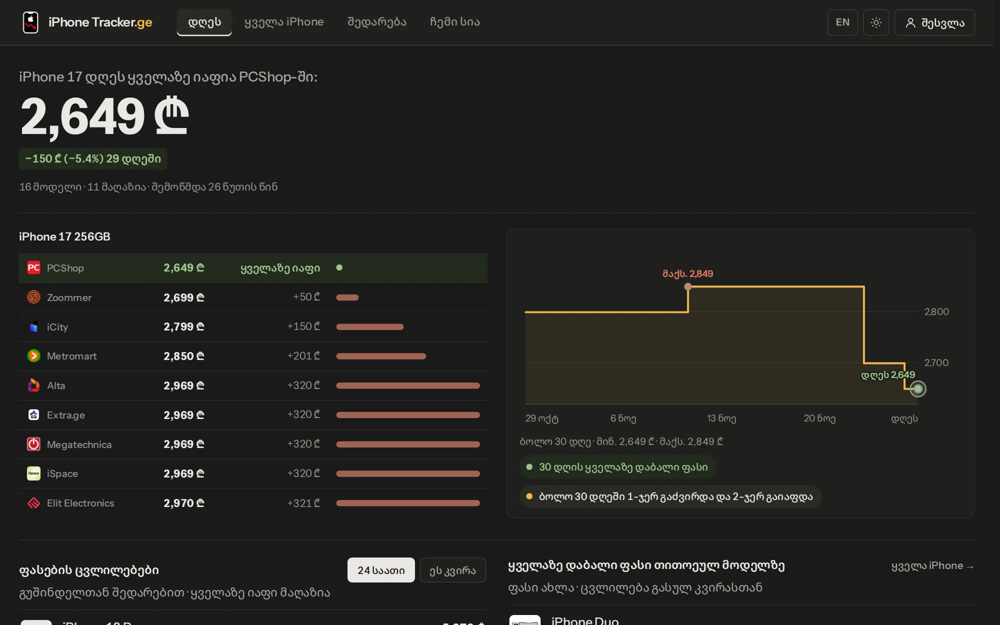
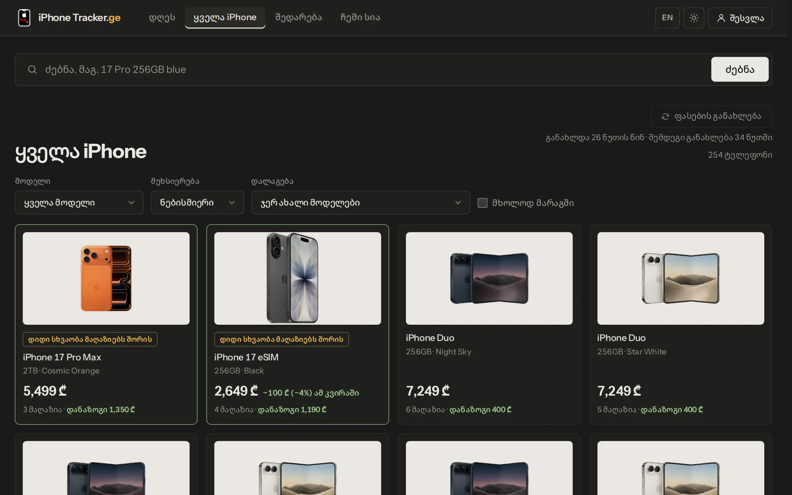
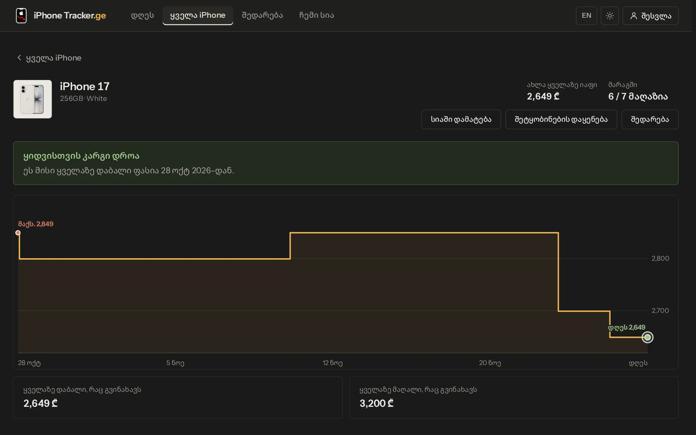
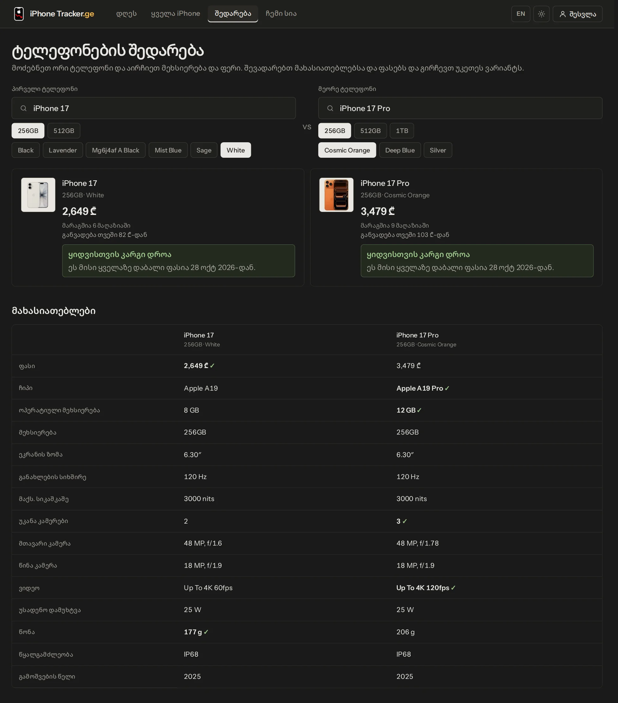

  
# Iphonetracker.ge

🌐 [iphonetracker.ge](https://iphonetracker.ge)

**iPhone price comparison and tracking for Georgian stores**

Collects prices from 11 retailers, records every price change, and tells you when it's the right time to buy.

---

<table>
  <tr>
    <td></td>
    <td></td>
  </tr>
  <tr>
    <td align="center">Today: the cheapest price at each store and its 30-day history</td>
    <td align="center">All iPhones: search, filters and price drops</td>
  </tr>
  <tr>
    <td></td>
    <td></td>
  </tr>
  <tr>
    <td align="center">Phone page: buy now or wait, with price history</td>
    <td align="center">Compare two phones spec by spec</td>
  </tr>
</table>

## Features

- Search the iPhone catalog by model and variant.
- Compare one phone across retailers: titles like "Apple iPhone 17 (8GB/256GB) - Sage" and
  "iPhone 17, 256 GB, Sage" are parsed into the same model, storage, and color.
- Filter by model, storage, and stock; sort by price, store savings, or store count.
- See the cheapest in-stock price per model on the Today page, price changes over the last 24 hours
  or the week, and lowest-recorded tags on catalog cards.
- Share or bookmark a phone: each one has its own link (`/iphone-17-pro-256gb-silver`; old `/?page=products&id=9` links redirect), and the server
  fills in its title, price, and photo for Facebook and Messenger previews.
- View price history for tracked products, with a "buy now or wait?" verdict that compares
  today's best price to its typical and lowest price over the last 90 days (after 14 days of history).
- Compare two phones spec by spec and get a pick weighed for what the phone is for
  (everyday, gaming, photo & video, keeping it for years, or saving money).
- Register an account, track products, and set, edit, or remove target-price alerts, or a
  back-in-stock alert for a phone no store currently has.
- Get alerts by email once the address is confirmed through an emailed link.
- Reset a forgotten password with a one-hour, single-use emailed link.
- Login, sign-up, and password-reset attempts are rate limited per IP, and an account locks
  for 15 minutes after 5 wrong passwords. Counts are kept in memory, so run one uvicorn worker.
- Refresh the catalog from Zoommer, Alta, iSpace, Elit Electronics, Megatechnica, Extra.ge, PCShop, Metromart, Gstore, Kontakt, and iCity automatically every 12 hours and record crawl outcomes.
- Refresh prices on demand from the catalog page (signed-in users, once per hour).
- Explore the REST API using Swagger UI (`/docs`, local only: it is off when `PROD=true`).
- About and privacy page, `robots.txt`, a `sitemap.xml` of every phone, and real 404s for unknown paths.

## Technology

- Python 3.12, FastAPI, Pydantic, async SQLAlchemy
- PostgreSQL and Alembic migrations
- Retailer-specific product scrapers
- Responsive HTML, CSS, and vanilla JavaScript frontend
- Docker Compose and Nginx
- pytest with HTTPX and SQLite test fixtures

## Scraping from a server

Zoommer, Alta, iSpace, Elit Electronics, PCShop, and Kontakt sit behind Cloudflare, which answers
datacenter IPs (Oracle, Hetzner, AWS, ...) with `403 Forbidden`. From a home connection they
work. On a server, set `SCRAPER_PROXY_URL` in `.env` and only those six stores use it:

- `socks5h://host.docker.internal:1080` with the reverse SSH tunnel in
  `scripts/home-tunnel.service`, which runs on an always-on machine at home (free).
- Any `http://` or `socks5://` proxy, such as a residential proxy with Georgian IPs.

If the proxy is down, the other stores still refresh and those six keep their last prices.
